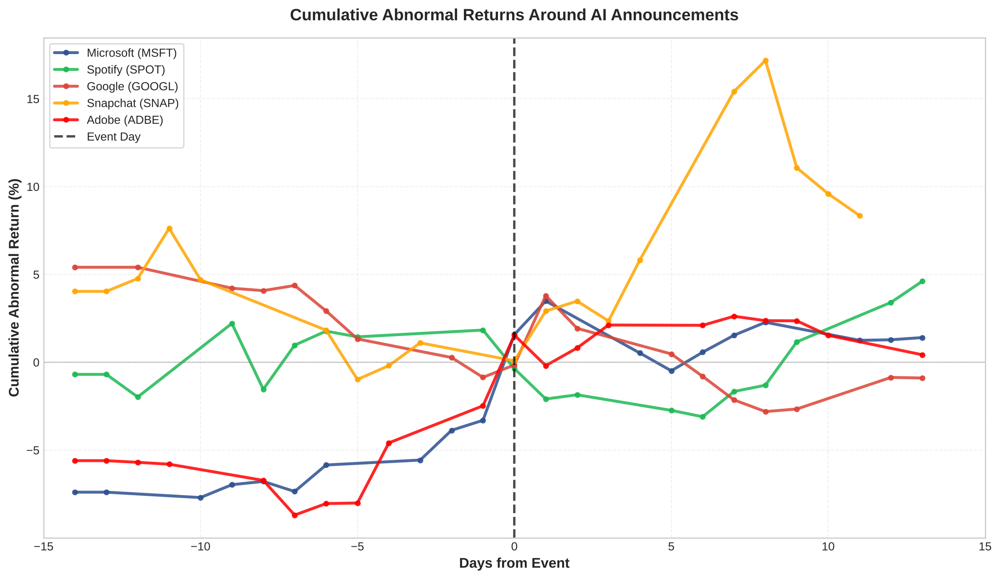
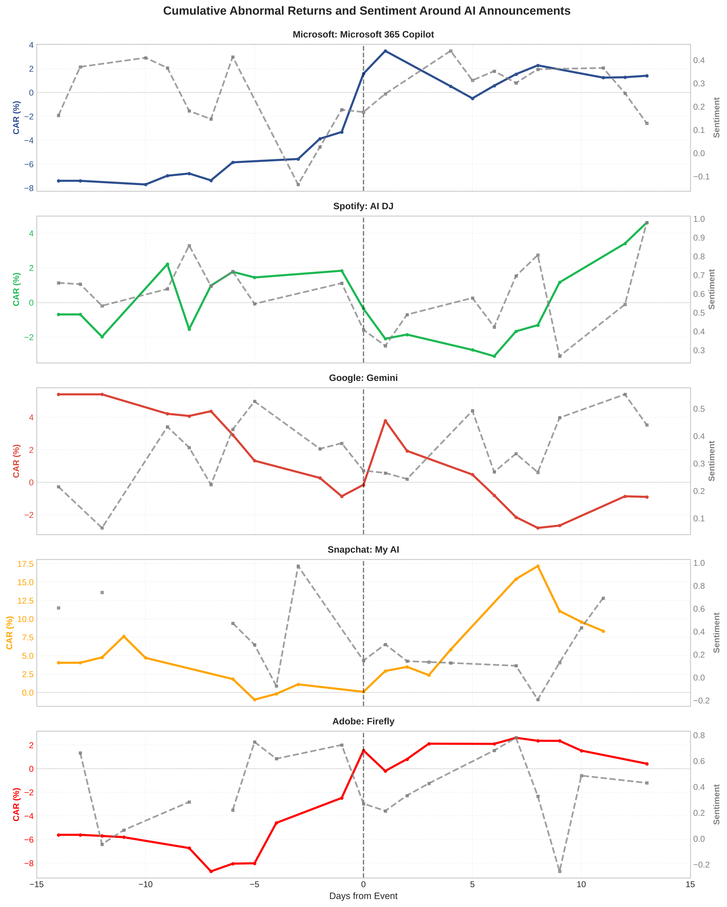
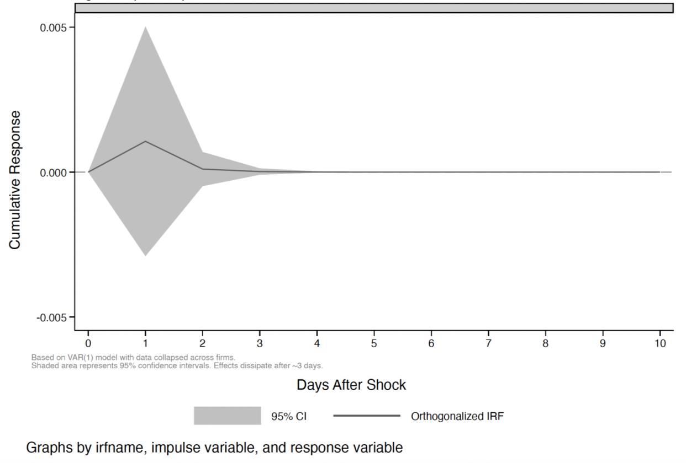

# Consumer Sentiment and Short-Term Market Responses to AI Feature Announcements

**Senior thesis, Bates College (Economics), December 2025** · Advised by Professor Austin Smith
📄 [Full paper (PDF)](paper/Jaenike_2025_Senior_Thesis.pdf) · 🖼️ [Poster](paper/Jaenike_2025_Thesis_Poster.pdf)

Does Reddit sentiment about a company's new AI feature predict how its stock moves over the next few days? This project builds a daily firm-level sentiment signal from Reddit posts and comments and tests whether it predicts abnormal returns around five 2023 AI product launches.

## Key findings

- **Sentiment predicts next-day abnormal returns, but not same-day returns.** Under a two-lag panel Granger specification, a one-unit increase in daily sentiment predicts about **2.2 pp higher abnormal returns the following day** (β = 0.0216, p = 0.028). Lagged sentiment is jointly significant (F(2,4) = 7.06, p = 0.049).
- **The relationship runs one way.** Lagged returns do not Granger-cause sentiment in any specification.
- **The effect is short-lived.** Impulse responses from a VAR show a sentiment shock fades within about three trading days.
- **Effects differ by firm.** Adobe shows a positive sentiment–return relationship, while Microsoft, Google, and Snapchat show negative ones.

<p align="center">
  
  <br><em>Cumulative abnormal returns around each announcement (day 0 = announcement).</em>
</p>

<p align="center">
  
  <br><em>CAR (solid) and daily Reddit sentiment (dashed) for each firm.</em>
</p>

<p align="center">
  
  <br><em>Orthogonalized impulse response of abnormal returns to a one-SD sentiment shock, VAR(1), 95% CI.</em>
</p>

## Data

| Firm | AI feature | Announcement | Reddit posts | Comments | Trading days |
|---|---|---|---:|---:|---:|
| Microsoft (MSFT) | 365 Copilot | 2023-03-16 | 203 | 3,390 | 20 |
| Spotify (SPOT) | AI DJ | 2023-02-22 | 61 | 591 | 19 |
| Google (GOOGL) | Gemini | 2023-12-06 | 262 | 4,189 | 19 |
| Snapchat (SNAP) | My AI | 2023-02-27 | 51 | 202 | 19 |
| Adobe (ADBE) | Firefly | 2023-03-21 | 82 | 674 | 20 |

- **Sentiment:** Posts and comments were collected with the Reddit API (PRAW) over a four-week window around each announcement (±14 days). Each firm has its own list of search terms and subreddits, defined at the top of its collector script. Posts are deduplicated and filtered for relevance. Comments come from each firm's top posts by score and by comment count. After filtering, the sample has 9,705 pieces of content. Each one is scored with VADER and TextBlob, and the scores are averaged by day to form a firm-level daily series. The analysis dataset uses the daily mean VADER compound score. Weekend activity is mapped to the nearest trading day.
- **Returns:** Daily prices and volume come from Yahoo Finance (`yfinance`). Abnormal returns are the firm's daily return minus the return on the NASDAQ-100 ETF (QQQ). Prices are adjusted for splits and dividends.

See [`data/README.md`](data/README.md) for what is and isn't included in this repo.

## Methods

1. **Baseline:** firm fixed-effects regressions of abnormal returns on same-day sentiment, with and without lagged returns, using SEs clustered by firm.
2. **Panel Granger causality:** tests whether lagged sentiment improves prediction of abnormal returns beyond past returns, plus the reverse direction. Uses one- and two-lag specifications, with lag length guided by AIC/BIC.
3. **VAR:** averages the firm-demeaned panel into daily series, then runs VAR(1) and VAR(2) Granger tests and computes orthogonalized impulse responses with bootstrapped 95% CIs.

## Repository structure

```
├── sentiment/          # Reddit collectors (one per firm) and VADER/TextBlob scoring
├── performance/        # yfinance price downloads and abnormal-return calculation
├── analysis/           # Merge and analysis do-files, plus figure scripts
├── data/               # Analysis dataset (daily firm-level panel) and data notes
├── figures/            # Figures from the paper
├── paper/              # Thesis and poster PDFs
├── requirements.txt
└── .env.example        # Template for Reddit API credentials
```

## Reproducing the analysis

To rerun the regressions from the included dataset (`data/merged_data.dta`, also provided as a CSV):

1. In Stata, install `estout` once: `ssc install estout`
2. Set the working directory to `analysis/` and run `do thesis_statistical_analysis.do`. It writes Tables 3–11 to `output/tables/`.

To redraw Figures 1 and 2, run `python plot_figures.py` from `analysis/`.

To rebuild the dataset from scratch:

1. Install Python dependencies: `pip install -r requirements.txt`
2. Create a Reddit app at reddit.com/prefs/apps. Copy `.env.example` to `.env` and fill in your credentials.
3. Run the collectors in `sentiment/`, then the scoring script. Save the scored daily file to `data/sentiment/`.
4. Run the scripts in `performance/` to download prices and compute abnormal returns. Save them to `data/performance/`.
5. From `analysis/`, run `load_and_merge.do`, then `thesis_statistical_analysis.do`.

Reddit search results change over time, so a fresh collection won't exactly match the original sample.

## Limitations

The sample is small, with five firms and short event windows. Reddit users skew toward tech-engaged audiences. The one-lag models, which AIC and BIC both prefer, show no significant effect, so the result depends on allowing slower adjustment. Adobe's Q1 2023 earnings release (March 15) falls inside its event window, six days before the Firefly announcement. See Section 5.1 of the paper.

## Contact

Mia Jaenike · [mjaenike.github.io](https://mjaenike.github.io) · [LinkedIn](https://www.linkedin.com/in/mia-jaenike-86b2b5296)
